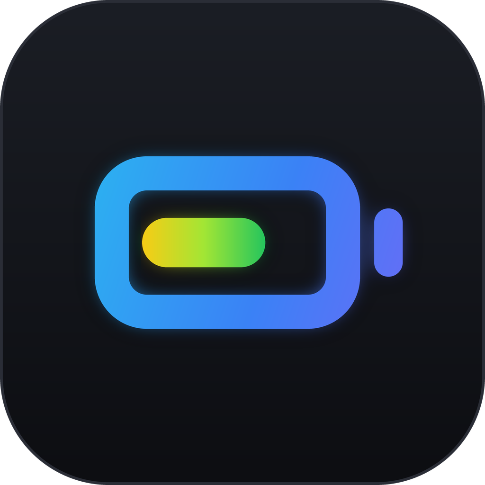

#  Battery Code

A small tab under the laptop camera, at the top centre of the screen. It is there **only while a battery device or an
external USB drive is connected**. Hover it and it slides open into an info bar showing up to 4 connections. Move the mouse
away and it closes.

*Made-up devices, drawn by the widget's own code (`batteryfloat.exe --demo`).*

## Install
Download `batteryfloat.exe` from the [latest release](https://github.com/roykersh/battery-code/releases/latest), put it
in a folder of your own (for example `C:\Tools\battery-float\bin`) and run it once. It adds itself to Windows startup.
There is nothing else to install: Windows 10/11 already ships .NET Framework 4.8.

To build it yourself instead: `tools\build.cmd` (writes `bin\batteryfloat.exe`).

## What the colours mean
| | Green / blue | Amber | Red |
|---|---|---|---|
| **Battery** (bar = charge left) | 50% and up (green) | under 50% | under 30% |
| **USB drive** (bar = free space) | 50% free and up (blue) | under 50% free | under 30% free |

- **Detail lines:**
  - AirPods with buds and a case show `L 70  R 80  Case 40`.
  - Drives show `free of 58 GB`.
  - AirPods that are connected but have not broadcast yet show `waiting for signal`.
- **Connected AirPods always show their last reading** in full colour, however old it is: AirPods go quiet for minutes
  while connected, so there is no grey "seen N min ago" state. When they disconnect (or the battery runs out) the item
  goes away after about 45 s, which rides out a quick reconnect.
- **Charging:** a bolt appears next to the value.
- **The closed tab** shows one short bar: the lowest battery, or the fullest drive when only drives are connected.
- **Up to 4 slots:** batteries come first, with room kept for up to 2 drives.

## Behaviour
- The tab opens once the pointer has stayed on it for 120 ms. It does not open while a mouse button is held, so window
  drags and Snap Layouts don't trigger it.
- Clicks pass through the closed tab.
- It closes 180 ms after the pointer leaves the bar.
- It hides while a fullscreen app or presentation runs.
- Right-click the open bar for Start with Windows, hide during fullscreen apps, Refresh, Diagnostics and Exit.
- **Bluetooth resets.** Turning Bluetooth off and on, sleep and resume, or a restart of the Bluetooth service can silently kill
  the advert listener. Battery Code rebuilds it on its own:
  - when Windows stops it;
  - when a scan finds it not running;
  - after resume from sleep;
  - from a watchdog when no advert at all arrives for 25 s, or when AirPods are connected but no reading has been
    accepted for 25 s. The watchdog backs off up to 5 min while things stay quiet.
- **After a device change** (and after resume) it rescans every 5 s for a minute, because AirPods come up one service at a time.
  A scan taken mid-reconnect that says "not connected" does not throw readings away: a device counts as connected for 45 s
  after a scan last saw it connected.
- Starts with Windows through `HKCU\Software\Microsoft\Windows\CurrentVersion\Run\BatteryFloat`. The value is rewritten on every
  start unless the menu option is unticked. Settings are in `%LOCALAPPDATA%\BatteryFloat\settings.ini`.
- It sits on the **primary** screen.

## Where the numbers come from
1. **Windows' own Bluetooth battery value** (the one in Settings > Bluetooth & devices): CfgMgr32,
   `{104EA319-6EE2-4701-BD47-8DDBF425BBE5} 2`. This covers most Bluetooth mice, keyboards and headsets.
2. **AirPods / Beats.** Windows never gets their battery, so it is read from the Apple BLE "proximity pairing" advert
   (company 0x004C, type 0x07, 27 bytes), decoded as OpenPods/AirPodsDesktop do. It comes in **10% steps**.
   - **Matching:** the advert address rotates, so a reading is used only when its model id matches AirPods *paired with this
     PC*. Only AirPods **connected to this PC** appear, and the signal must be at least -75 dBm.
     Other people's AirPods are ignored, and **AirPods connected to a phone or anything else never show**: only devices connected to this PC appear.
   - **Model id:** bytes 3-4, little-endian. For example `1F 20` = 0x201F, the AirPods Max (USB-C), the same as `PID&201F` in the Windows device id.
   - **Levels:** byte 6 holds the two bud nibbles (0-10 = x10%), and status bit 5 says which nibble is left. Byte 7 holds the
     charging bits and the case level. One-battery models (Max, Solo, Studio...) take the larger nibble.
3. **External drives:**
   - every Removable drive;
   - Fixed drives whose storage bus is USB, SD or MMC (`IOCTL_STORAGE_QUERY_PROPERTY`);
   - never the system drive, nor virtual drives such as Google Drive.

**Not covered:** 2.4 GHz dongle devices such as Logitech Lightspeed or Razer HyperSpeed need vendor protocols, so use the free
HaloBattery (github.com/HeyOkay/HaloBattery) for those. Thunderbolt/NVMe external SSDs report the NVMe bus and are left out.

## Files and commands
- `bin\batteryfloat.exe`: the app. It is one small exe with no installs (.NET Framework 4.8 and WinRT Bluetooth).
- `tools\batteryfloat.cs`, `tools\build.cmd`: the source, built with the in-box `csc.exe` (C# 5). Exit the app before rebuilding.
- `batteryfloat.exe --dump <file>`: a diagnostic report. It lists the Bluetooth devices, the Windows battery values, the paired
  Apple models, and every drive with its bus type and why it was included or excluded. It then logs 12 s of Apple adverts with the
  accept/ignore reason for each.
- `%LOCALAPPDATA%\BatteryFloat\live-status.txt`: the running app rewrites it every 30 s. It shows the listener state, how often
  it was rebuilt and why, how long ago an advert (any, Apple battery, accepted) arrived, the age of the last device scan, and
  the items shown. Right-click > **Diagnostics** rewrites it and opens it in Notepad. Use it when the bar looks wrong;
  `--dump` starts a separate listener, so it cannot see the running app's state.
- `batteryfloat.exe --pinned`: stays open, for screenshots.
- To rebuild the GIF: `batteryfloat.exe --demo <dir>`, then `py -3.13 tools\make_gif.py <dir>`. The result goes to `assets\showcase.gif`.

## What it touches
- **Registry**: `HKCU\Software\Microsoft\Windows\CurrentVersion\Run\BatteryFloat` (start with Windows). Untick the menu option to
  remove it.
- **Files**: `%LOCALAPPDATA%\BatteryFloat\settings.ini` and `live-status.txt`, plus the report or frames you ask for with
  `--dump` / `--demo`.
- **Bluetooth and drives**: read only. It listens to BLE adverts and reads battery and free-space values, and never pairs,
  connects or writes anything.
- **Network**: none.

## License

MIT
